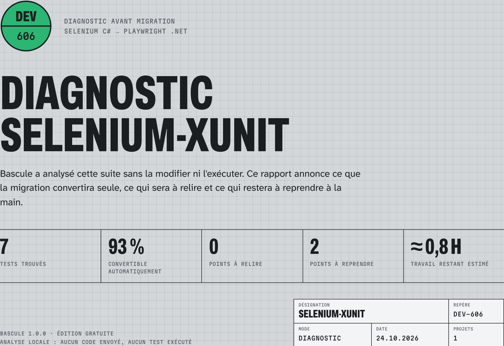

# Bascule

Diagnostic d'une suite de tests **Selenium C#** avant sa migration vers **Playwright .NET**. Vous pointez la solution, et vous savez en quelques secondes, fichier par fichier et ligne par ligne :

* combien de tests, de page objects et d'usages de Selenium vous avez, par projet et par cadre (NUnit, MSTest, xUnit) ;
* la **part qui se convertit automatiquement** : sélecteurs `By`, actions, lectures, attentes explicites et implicites, `SelectElement`, `Actions`, cadres, alertes, cookies, scripts, captures, cycle de vie du navigateur ;
* ce qui est **à relire** après conversion (une sémantique qui change un peu) et ce qui est **à reprendre à la main** (fenêtres par identifiant, scripts asynchrones, grille distante, Appium…), avec l'emplacement exact et l'indication de ce qu'il faut écrire à la place ;
* un **ordre de grandeur du travail restant**, en heures.

Rien n'est compilé, rien n'est exécuté, rien n'est envoyé : Bascule lit le code avec Roslyn, le compilateur C#, et embarque les métadonnées de l'API Selenium. La suite n'a pas besoin de compiler ni d'être restaurée.



Rapports d'exemple sur les suites de démonstration du dépôt : [diagnostic](https://consigne.github.io/bascule/exemple/diagnostic.html) (édition gratuite) et [migration](https://consigne.github.io/bascule/exemple/migration.html) (édition Pro, avec le diff avant / après de chaque fichier).

## Installation

Il faut le **SDK .NET 8** ou plus récent (Windows, macOS ou Linux).

Téléchargez `Bascule.1.0.0.nupkg` depuis la [dernière version](https://github.com/consigne/bascule/releases/latest), puis, dans le dossier du téléchargement :

```bash
dotnet tool install --global Bascule --version 1.0.0 --add-source .
```

Ou depuis les sources :

```bash
git clone https://github.com/consigne/bascule && cd bascule
dotnet run --project src/Bascule -c Release -- diagnostic /chemin/vers/MaSuite.sln
```

## Utilisation

```bash
bascule diagnostic MaSuite.sln
bascule diagnostic ./tests/MonProjet.Tests --rapport ./audit
```

Le chemin peut être un dossier, une solution (`.sln`, `.slnx`) ou un projet (`.csproj`). Bascule écrit `bascule-rapport.html` (autonome, lisible hors ligne, imprimable) et `bascule-rapport.json` à côté de la suite, ou dans le dossier donné par `--rapport`.

```text
Analyse de /src/Atelier.Tests : 1 projet(s)…
Rapport : /src/Atelier.Tests/bascule-rapport.html

  Tests trouvés            17
  Usages convertibles      91
  À relire                 3
  À reprendre à la main    0
  Part automatique         97 %
  Travail restant estimé   ≈ 0,5 h (ordre de grandeur, pas un devis)
```

Codes de retour : `0` si l'analyse a abouti, `1` sans commande (l'aide s'affiche), `2` pour une erreur d'utilisation (chemin introuvable, option inconnue), `3` (édition Pro, avec `--compiler`) si la suite migrée ne compile pas.

## Ce que contient le rapport

| Section | Contenu |
|---|---|
| Synthèse | tests, part automatique, points à relire et à reprendre, heures restantes, répartition par catégorie |
| À reprendre | chaque point manuel : fichier, ligne, code concerné, ce qu'il faut écrire en Playwright ; filtrable |
| À relire | les conversions dont le comportement change légèrement (attente, ordre, texte visible) |
| Conversions | un échantillon par catégorie de ce qui sera réécrit automatiquement |
| Projets | cadre de test, fichiers, tests, paquets Selenium et version de .NET |
| Méthode et limites | comment les chiffres sont calculés, ce que l'outil ne voit pas |

Le JSON contient les mêmes données, pour un tableau de bord ou une comparaison dans le temps. Le détail des règles est dans [docs/regles.md](docs/regles.md).

## Ce qui est pris en charge

* Cadres de test : **NUnit 3 et 4, MSTest 2 et 3, xUnit 2**. Une suite Reqnroll ou SpecFlow est analysée au niveau de ses définitions d'étapes.
* Projets au format SDK, de .NET Core 3.1 à .NET 10. Les projets .NET Framework au format ancien sont analysés et signalés.
* Selenium 3 et 4, `SeleniumExtras.WaitHelpers`, `SeleniumExtras.PageObjects` (`[FindsBy]`), `WebDriverManager`.
* Page objects, classes de base, méthodes utilitaires qui reçoivent un `IWebDriver`, un `IWebElement` ou un `By`.

## Édition gratuite et édition Pro

| | Gratuite (ce dépôt, MIT) | Pro (licence par organisation) |
|---|---|---|
| Diagnostic complet, rapport HTML et JSON | ✓ | ✓ |
| Réécriture du code en Playwright .NET (`bascule migrer`) | | ✓ |
| Projet `.csproj` converti, versions minimales relevées | | ✓ |
| Classe de base `PageTest` du cadre de test, ou cycle de vie conservé | | ✓ |
| Suite migrée recompilée : chaque erreur apparue devient un point « à reprendre » (et `dotnet build` avec `--compiler`) | | ✓ |
| Rapport de migration avec le diff avant / après de chaque fichier | | ✓ |

L'édition Pro est vendue **290 € HT par organisation**, postes illimités, mises à jour pendant 12 mois : [consigne.gumroad.com/l/bascule-pro](https://consigne.gumroad.com/l/bascule-pro). Le diagnostic gratuit en donne une estimation proche : les deux éditions partagent les mêmes règles de conversion, mais seule la migration recompile la suite, elle trouve donc un peu plus de points (comparaison dans [docs/resultats.md](docs/resultats.md)).

Pour une migration faite pour vous, au forfait et entièrement à distance (pilote, paquets de 100 ou 300 tests, livrée par pull request) : [bascule.pages.dev](https://bascule.pages.dev/).

## Limites

* Analyse statique : Bascule ne lance pas vos tests et ne connaît pas votre application. Un test instable sous Selenium le restera après migration.
* Les estimations d'heures sont des ordres de grandeur (20 min par point à reprendre, 5 min quand le même point se répète dans un fichier, 4 min par point à relire, 1 min par test pour la vérification), pas un devis.
* Les fenêtres repérées par identifiant, `ExecuteAsyncScript`, la grille Selenium distante, Appium et le code qui traverse des cadres en appelant d'autres méthodes ne sont pas convertis automatiquement : ils sont signalés.
* Questions fréquentes : [docs/faq.md](docs/faq.md).

## Construire et tester

```bash
dotnet build -c Release
dotnet test
```

Les trois suites de démonstration (`exemples/atelier/`) visent un petit site statique fourni (`exemples/atelier/site/`). Bascule ne contient ni ne télécharge aucun navigateur.

## Licence

MIT, voir [LICENSE](LICENSE). Composants tiers : [THIRD-PARTY-NOTICES.txt](THIRD-PARTY-NOTICES.txt).

Selenium est un projet de la Software Freedom Conservancy ; Playwright est une marque de Microsoft Corporation. Bascule n'est affilié à aucun des deux projets.

Contact : support@consignestudio.fr
